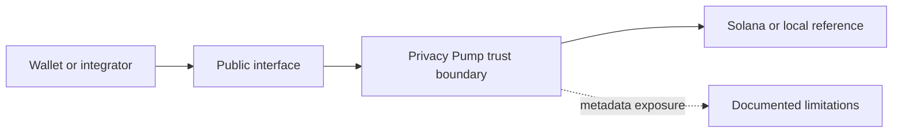

# privacy-pump-private-vault-program

> **Maturity:** Experimental devnet program  
> **Supported network:** Devnet and local validator  
> **Audit status:** Publication is not an audit. No external audit is claimed.

Anchor program underlying Privacy Pump Personal Vault and Private Multisig authorization.

## Purpose

Publishes the reviewed on-chain boundary shared by the one-member Personal Vault product and multi-member Private Multisig.

## Scope

- Factory-created vault PDAs
- Signer commitment root and version authorization
- Proposal, nullifier, fee-cap, reimbursement, and execution rules

## Architecture



See [ARCHITECTURE.md](ARCHITECTURE.md) for component boundaries and assumptions.

## Current security status

- Experimental or reference material; not mainnet-ready.
- The inspected devnet programs are upgradeable and shared one upgrade authority at the publication audit date.
- Factory and relayer are distinct protocol roles, but a deployment may configure one signer for both.
- Production signer topology is intentionally not published.
- The ZK Pool vault-creation fee receipt does not independently bind its signer named `factory` to the Private Vault config factory; that boundary is under review.
- The ZK verifier path is fail-closed by default and is not a complete production privacy system.
- Browser, RPC, relayer, database, Waku/Logos, and Arcium metadata each have separate privacy limitations.
- Custom cryptographic glue is not described as audited.

Read [SECURITY.md](SECURITY.md) before using any material.

## Dependencies

- Anchor
- Privacy Pump Arcium receipt interface
- Privacy Pump ZK Pool research interface

## Local setup

Use deterministic fixtures and ephemeral local keys only. No production credentials, cloud accounts, private RPC endpoints, or real wallet relationships are required.

```text
node scripts/policy-scan.mjs

cargo fmt -- --check
cargo clippy --all-targets
cargo test
anchor build
```

`anchor build` is local build verification only. It does not deploy the program. The checked-in public IDL under `generated/idl` was generated from this staged source.

## Roadmap

- [ ] Complete independent security review
- [ ] Stabilize CPI interfaces
- [ ] Publish reproducible generated IDL

## Related Privacy Pump repositories

- No public runtime repository dependency.

## Known limitations

- Public content omits production relayer, access-control, KMS, Supabase service-role, keeper-signing, monitoring, and deployment implementations.
- Privacy depends on more than user-interface masking; metadata visible to wallets, RPCs, relayers, transports, and infrastructure remains relevant.
- Interfaces may change while the devnet architecture is stabilized.

## Contributing

See [CONTRIBUTING.md](CONTRIBUTING.md). Licensing is under review; see [LICENSE_STATUS.md](LICENSE_STATUS.md).

```

```
